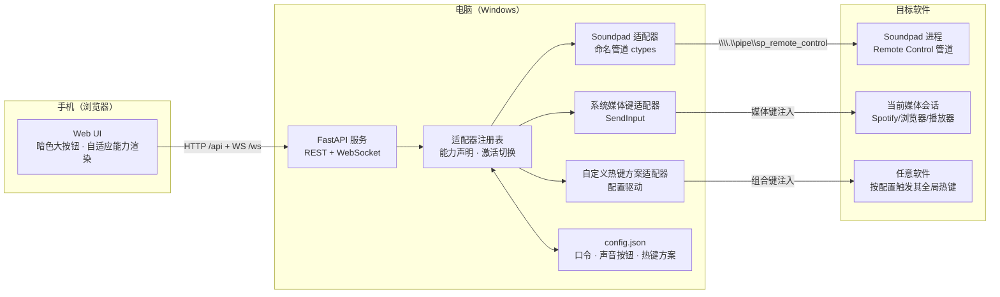

# CompanionDeck 设计文档：头脑风暴 · 架构 · 扩展指南

## 1. 需求与痛点

用户打游戏时会用到 Soundpad（把声音/音乐播进游戏语音）。Soundpad 作为后台窗口运行，导致：

- 切歌、播放/暂停必须 **Alt-Tab** 切出游戏，打断操作、可能暴露桌面
- 键盘上没有顺手的热键，或热键与游戏按键冲突
- 无法看到当前播放状态、声音列表、音量

目标：**在不打断游戏的前提下完成音乐控制**。同时，这套能力不应只服务 Soundpad——用户希望它是一个**可进化的通用软件**，未来能适配任何软件（播放器、直播工具、游戏内媒体等）。

## 2. 方案头脑风暴

| # | 候选方案 | 优点 | 缺点 | 结论 |
| --- | --- | --- | --- | --- |
| A | 全局热键 + 热键模拟（SendInput） | 零依赖、对任意软件通用 | 需逐软件配置、可能与游戏热键冲突、无法读取状态/列表/音量 | 保留为**通用兜底**（mediakeys / profile 适配器） |
| B | **Soundpad 官方 Remote Control API**（命名管道） | 原生命令：播放/暂停、上下首、停止、音量、状态、声音列表、按索引播放；无需任何配置 | 只支持 Soundpad | **首选方案**（soundpad 适配器） |
| C | UI Automation / 窗口消息 | 不依赖 API | 脆弱、版本敏感、侵入性高 | 放弃 |
| D | Windows SMTC（系统媒体传输控制） | 通用、可读曲目/歌手/进度 | 需第三方库（winsdk）、Py3.14 兼容性风险；依赖媒体应用接入 SMTC | 列入 Roadmap（可选适配器） |
| E | 局域网 Web 控制台 | 手机/平板即用、零客户端安装、跨设备 | 需同一网络 | **采用**（配套 B 与 A） |
| F | 第三方现成方案（Soundpaddon 等） | 已存在浏览器控制实现 | 只服务 Soundpad、不可扩展、UI 不贴合需求 | 仅作参考与排雷 |

**结论**：以「E 局域网 Web 控制台」为交互层，以「B 官方 RC 管道」为 Soundpad 首选通道，以「A 热键模拟」为通用兜底，用**适配器框架**把三者统一起来，形成可扩展的软件骨架。

> 关键事实：Soundpad 官方提供内建 Remote Control Interface（协议 v1.1.2），通过命名管道 `\\.\pipe\sp_remote_control` 通信，响应为 HTTP 风格状态码（R-200 等）。此接口被官方 Java 参考实现、.NET/JS/Python/Rust 社区库广泛使用（参考官方 RC 页面与 SoundpadRemoteControl.java）。

## 3. 命名头脑风暴

候选：CompanionDeck / PocketDeck / SoundBridge / TuneDeck / GamePilot / SideDeck / LanControl

最终选定 **CompanionDeck（伴侣操控台）**：

- 「Deck」与 Stream Deck 联想一致——手机上的一块控制面板
- 「Companion」点出定位：陪伴在游戏/工作旁边，不打断
- 不绑定 Soundpad 名字，符合「未来适配所有软件」的定位

## 4. 架构



### 数据流

1. 手机 Web UI 通过 REST（`/api/*`）触发动作，鉴权为 `Authorization: Bearer <token>`
2. 服务端把动作路由到**当前激活适配器**的对应方法
3. 适配器通过对应通道（命名管道 / SendInput）作用到目标软件
4. 服务端每 1.5s 通过 WebSocket 推送聚合状态（播放状态、进度、音量、在线状态）
5. 声音列表/曲目列表按需通过 `/api/tracks` 拉取（避免高频推送大列表）

## 5. 适配器框架设计（核心）

### 5.1 能力模型

适配器声明能力集合，UI 据此自动渲染控件：

| 能力 | 含义 | UI 表现 |
| --- | --- | --- |
| `play_pause` `next` `prev` `stop` | 传输控制 | 大按钮组 |
| `volume` | 音量 | 滑杆 + 静音 + ± |
| `tracks` | 可读声音/曲目列表 | 可筛选列表，点击播放 |
| `sounds` | 声音面板按钮 | 网格按钮 |
| `state` | 播放状态/进度 | 正在播放卡片 + 进度条 |

### 5.2 接口

所有适配器继承 `deck/adapters/base.py` 的 `BaseAdapter`：

```python
class MyAdapter(BaseAdapter):
    name = "myapp"
    display_name = "我的软件"
    capabilities = {"play_pause", "next", "prev", "volume"}

    def available(self) -> bool: ...          # 目标软件是否可连
    def play_pause(self) -> None: ...         # 实现需要的操作即可
    def get_playback(self) -> PlaybackInfo: ...
```

### 5.3 三种接入路径（由易到难）

**路径 1：系统媒体键（零配置）** —— 使用内置 `mediakeys` 适配器。适用于任何接入 Windows 媒体会话的软件，无需写代码。

**路径 2：自定义热键方案（零代码）** —— 在 `config.json` 的 `adapters.profile.profiles` 中为任意软件定义热键，手机即可控制。适合「软件有全局热键」的场景（OBS、播放器、游戏内快捷键等）。组合键命名见 `deck/hotkeys.py`。

**路径 3：编写适配器（推荐用于深度集成）** —— 新建 `deck/adapters/xxx.py`，继承 `BaseAdapter`，实现能力方法，加入 `deck/adapters/__init__.py` 的 `BUILTIN_ADAPTERS`。适合有官方 API / 管道 / HTTP 接口的软件（如 Spotify Web API、OBS WebSocket、VLC HTTP 接口等）。

### 5.4 为什么这样设计

- **能力驱动渲染**：新适配器无需改动前端，UI 自动按能力出现控件
- **同步接口 + 线程池**：阻塞式管道调用由 FastAPI 自动放到线程池，互不阻塞
- **降级可用**：目标软件离线时，状态层标记 `adapter_available=false`，前端显示「目标离线」而非报错
- **配置即持久化**：适配器切换、方案切换自动写回 config.json

## 6. 安全模型

- 默认开启**访问口令**（Token）：首次运行自动生成，REST 用 Bearer Header，WebSocket 用查询参数，常量时间比较
- 服务默认监听 `0.0.0.0:8390`，暴露于局域网；口令防止同一网络内他人误操作
- `config.json` 含口令，已被 `.gitignore` 排除，**切勿提交仓库**
- 如需更强安全性：可将 host 改为 127.0.0.1 仅本机使用，或置于可信 VLAN 后

## 7. 验证方式

- `tests/test_api.py`：桩适配器 + TestClient 冒烟测试（鉴权、状态、传输、音量、声音播放、列表、切换）
- 手动联调：启动服务 → 手机/本机浏览器访问 → 切适配器 → 触发动作 → 观察状态推送
- Soundpad 真实联调需 Soundpad 进程运行（本机已确认安装 `%APPDATA%\Leppsoft\soundlist.spl` 存在）

## 8. Roadmap

1. **SMTC 适配器**（winsdk）：读取任意媒体会话曲目/歌手/进度，覆盖 Soundpad 之外的媒体软件
2. **系统托盘 + 开机自启**：常驻后台，无需开窗口
3. **二维码 + PWA**：手机扫码即连，安装到桌面
4. **开箱适配器示例**：OBS（WebSocket）、Spotify（本地/Web API）、VLC（HTTP）、游戏媒体
5. **插件化**：适配器以 pip 包安装即注册
6. **多设备会话**：多个手机同时连接、状态同步

## 9. 参考与排雷

- 官方 RC 接口：https://www.leppsoft.com/soundpad/en/rc/ ；参考实现 SoundpadRemoteControl.java（v1.1.2）
- 社区实现：`soundpadrc`（PyPI）、`soundpad.py`（GitHub）、`soundpad-rs`、`soundpad-web`（sonodima）等——可参考，但本项目自研管道客户端以保持零依赖与可控
- **排雷清单**：
  - 命名管道请求间隔过密会损坏管道（官方实现做了同毫秒节流）——本项目每个请求独立连接/关闭，天然规避
  - 管道读取不能无脑阻塞 `ReadFile`——本项目用 `PeekNamedPipe` 轮询 + 超时，避免卡死
  - `GetSoundlist()` 返回 XML 字段命名跨版本可能不同——解析器做了大小写/多字段/正则兜底
  - SendInput 模拟热键在极少数反作弊严格的全屏独占游戏里可能不生效——游戏场景优先使用 Soundpad 原生管道
